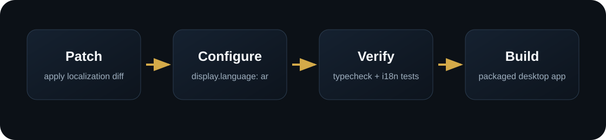

<p align="center">
  
</p>

<p align="center">
  
</p>

<p align="center">
  <a href="README.md">English</a>
  ·
  <a href="https://github.com/3ssiri/hermes-arabic-localization/issues">المشاكل والاقتراحات</a>
  ·
  <a href="https://github.com/NousResearch/hermes-agent">Hermes Agent</a>
</p>

# تعريب Hermes Desktop

> [!IMPORTANT]
> **🎉 المهمة اكتملت — دُمج هذا المشروع في المشروع الأم.**
> منذ 2026-07-24 أصبحت اللغة العربية (مع دعم كامل للكتابة من اليمين لليسار) جزءاً أصيلاً من
> Hermes Desktop
> ([NousResearch/hermes-agent@`5b6990e7a`](https://github.com/NousResearch/hermes-agent/commit/5b6990e7a)
> — بمشاركة ترجمة هذا المستودع ونسبتها لصاحبها). لم تعد بحاجة إلى هذه الرقعة —
> حدّث Hermes واختر العربية من الإعدادات. يبقى المستودع للتوثيق التاريخي، وقد أُوقفت
> مراقبة التوافق مع المنبع. التحسينات القادمة على الترجمة تذهب مباشرة إلى
> [NousResearch/hermes-agent](https://github.com/NousResearch/hermes-agent).

إضافة اللغة العربية إلى واجهة **Hermes Desktop** من خلال ملف patch وسكربتات تطبيق.

هذا المستودع لا يوزع نسخة معدلة كاملة من Hermes. هو يطبق التعريب على نسخة Hermes الموجودة لديك، يضبط اللغة العربية، ثم يشغل فحوصات الواجهة.

المشروع الأصلي: https://github.com/NousResearch/hermes-agent

طلب الدمج الرسمي: https://github.com/NousResearch/hermes-agent/pull/45619 — **دُمج في 2026-07-24**

المشرف على التعريب: **علي عسيري** · X: https://x.com/3li3

## لماذا هذا المستودع؟

بُني التعريب هنا ثم أُرسل إلى المشروع الأصلي، ليجد المستخدمون العرب طريقة عملية لتجربته ريثما تكتمل المراجعة الرسمية. وقد اكتملت المراجعة، وصار التعريب جزءاً من Hermes Desktop نفسه. يبقى المستودع متاحاً كسجل لكيفية إعداد العمل ومراجعته، فهو يوزع ملف patch وسكربتات تطبيق، لا نسخة معدلة من Hermes.

## التثبيت

> [!NOTE]
> هذه الخطوات لازمة فقط لنسخة Hermes أقدم من `5b6990e7a` (2026-07-24). أما النسخ الأحدث
> فالتعريب فيها أصلي — حدّث Hermes واختر العربية من
> Settings ← Appearance ← Language.

افتح PowerShell:

```powershell
git clone https://github.com/3ssiri/hermes-arabic-localization.git
cd hermes-arabic-localization
.\scripts\apply-arabic.ps1 -Build
```

المسار الافتراضي لـ Hermes:

```text
%LOCALAPPDATA%\hermes\hermes-agent
```

إذا كان Hermes في مسار آخر:

```powershell
.\scripts\apply-arabic.ps1 -HermesPath "C:\path\to\hermes-agent" -Build
```

بعد البناء، شغل التطبيق من:

```text
%LOCALAPPDATA%\hermes\hermes-agent\apps\desktop\release\win-unpacked\Hermes.exe
```

## ماذا يضيف؟

- العربية (`ar`) كلغة في واجهة سطح المكتب.
- اتجاه RTL في واجهة Electron.
- تعريب الإعدادات.
- تعريب المزودين والحسابات ومفاتيح API.
- تعريب Tools & Keys.
- تعريب MCP.
- تعريب المحادثات المؤرشفة.
- تعريب صفحة حول ومنطقة إزالة التثبيت.
- اختبارات خاصة بسلوك اللغة العربية.

## ماذا لا يغير؟

- سلوك الوكيل.
- الرسائل النظامية.
- أدوات النموذج.
- واجهات الخلفية.
- منطق المزودين.
- لوحة Dashboard.

## آلية العمل

<p align="center">
  
</p>

السكربت الأساسي:

```text
scripts/apply-arabic.ps1
```

يطبق:

```text
patches/desktop-arabic-localization.patch
```

ثم يضبط:

```yaml
display:
  language: ar
```

## التحقق

```powershell
cd $env:LOCALAPPDATA\hermes\hermes-agent\apps\desktop
npm run typecheck
npm run test:ui -- src/i18n/runtime.test.ts src/i18n/languages.test.ts src/i18n/context.test.tsx src/components/language-switcher.test.tsx
```

## الملفات

| المسار | الغرض |
| --- | --- |
| `patches/desktop-arabic-localization.patch` | ملف التعريب |
| `scripts/apply-arabic.ps1` | تطبيق التعريب على Windows |
| `scripts/apply-arabic.sh` | تطبيق التعريب على macOS/Linux |
| `scripts/verify.ps1` | تشغيل فحوصات التعريب |
| `docs/` | شروحات التثبيت والتحديث وحل المشاكل |
| `.github/workflows/` | متابعة المشاكل (مراقبة المنبع المجدولة أُوقفت) |

## الحقوق

إعداد وصيانة التعريب العربي:

- علي عسيري
- البريد الإلكتروني: assiri@gmail.com
- X: https://x.com/3li3

تبقى حقوق Hermes Agent وترخيصه الأصلي محفوظة للمؤلفين والمساهمين الأصليين.
